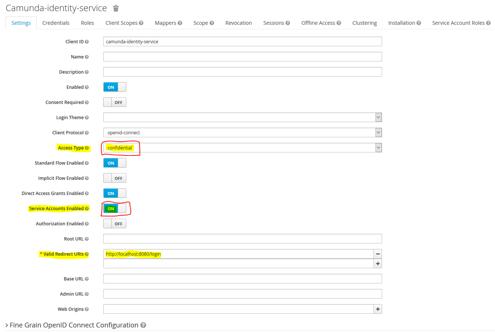
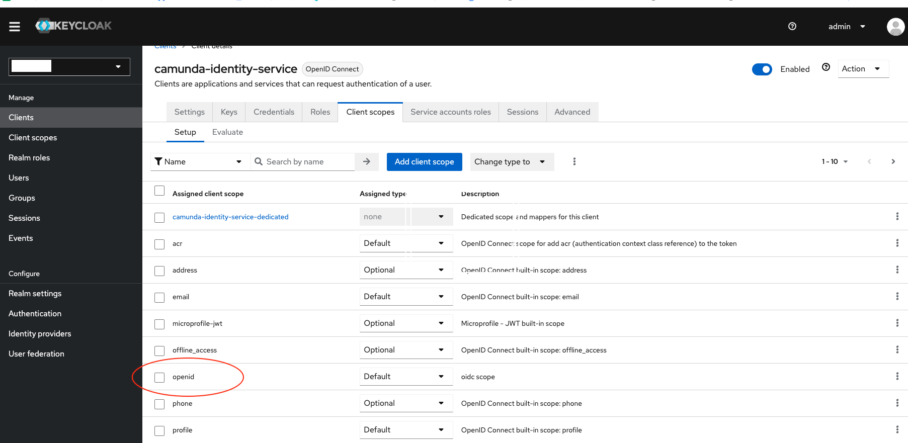
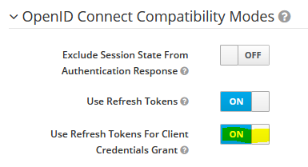
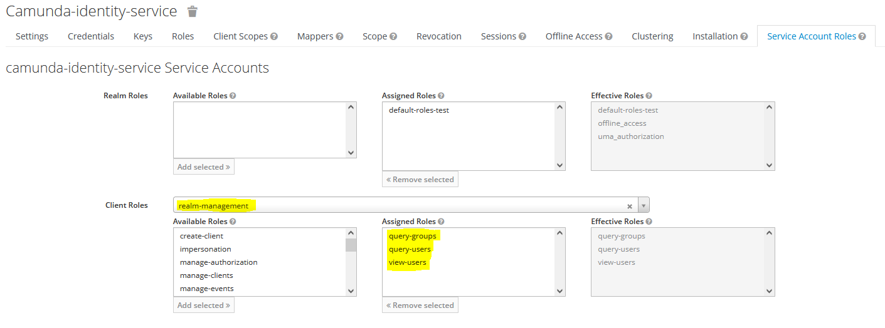
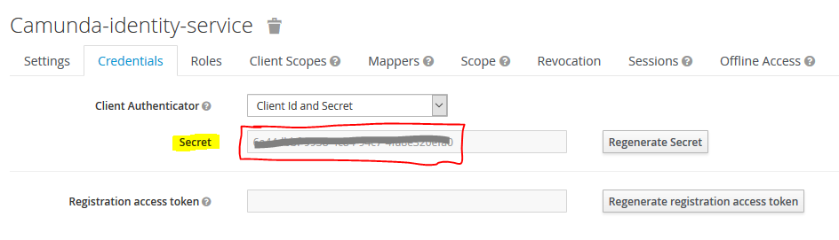
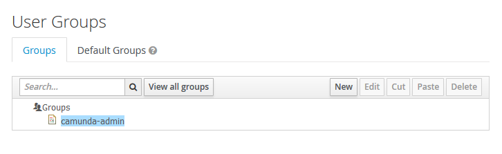

# Fluxnova - Keycloak Identity Provider Plugin

Keycloak&trade; (<https://www.keycloak.org/>) is an Open Source Identity and Access Management platform including advanced features such as User Federation, Identity Brokering and Social Login.

This plugin is a port of the [Camunda Platform 7 Keycloak Identity Provider Plugin](https://github.com/camunda-community-hub/camunda-platform-7-keycloak) 7.24 to Fluxnova. Its Java package `org.finos.fluxnova.bpm.extension.keycloak` is exactly what the [Fluxnova migrator](https://github.com/finos/fluxnova-bpm-platform/tree/main/migrator) produces from the original package, and all configuration property names are unchanged, so the migrator also updates class names in existing configurations. The Maven coordinates change to `org.finos.fluxnova.bpm.extension:fluxnova-keycloak` and have to be updated by hand. The JWT extension and the examples of the original plugin are not part of this port.

**Why this plugin?** SSO is sufficient in case you only want authentication but have no further advanced security roles. If one needs to use Fluxnova's IdentityService APIs or wants to see actual Users and Groups show up in Cockpit and Admin, a custom IdentityProvider needs to be implemented as well.

This plugin provides the basis for using Keycloak as Identity Management solution and will provide a ReadOnlyIdentityProvider. What you will get is a fully integrated solution for using Keycloak as an Identity Provider in Fluxnova receiving users and groups from Keycloak. The authorization of these users and groups for Fluxnova resources itself remains within Fluxnova. This plugin allows the usage of Keycloak as Identity Provider even without SSO.

**Beware: in case you want to use Keycloak's advanced login capabilities for social connections you must configure SSO as well.**
Password grant exchanges are only supported for Keycloak's internally managed users and users of an LDAP / Keberos User federation. Hence without SSO you will only be able to login with users managed by such connections.

The tests run against Keycloak `26.8.2` and Fluxnova `3.0.0`.

Known limitations:

*   A strategy to distinguish SYSTEM and WORKFLOW groups is missing. Currently only the administrator group is mapped to type SYSTEM.
*   Some query filters are applied on the client side - the Keycloak REST API does not allow full criteria search in all required cases.
*   Sort criteria for queries are implemented on the client side - the Keycloak REST API does not allow result ordering.
*   Tenants are currently not supported.

## Prerequisites in your Keycloak realm

1. Keycloak docker images can be found on [Keycloak Docker Hub](https://hub.docker.com/r/keycloak/keycloak "Keycloak Docker Images").
2. Create a new client named `camunda-identity-service` with access type confidential and service accounts enabled:
    
   Please be aware, that beginning with Keycloak 18, you do not only have to configure a valid redirect URL, but
   a valid post logout redirect URL as well. To keep things easy values can be the same.
3. Since Keycloak 20, user queries require an 'openid' scope for OIDC clients. To enable this, create an 'openid' scope under client scopes and add add this the `camunda-identity-service` client.
 
4. In order to use refresh tokens set the "Use Refresh Tokens For Client Credentials Grant" option within the "OpenID Connect Compatibility Modes" section (available in newer Keycloak versions):

    
5. Add the roles `query-groups, query-users, view-users` to the service account client roles of your realm (choose `realm-management` or `master-realm`, depending on whether you are using a separate realm or master):
    
6. Since Keycloak 26.8.2, the Admin REST API only accepts tokens that carry the built-in `kc-admin-api` client scope. Add this scope to the `camunda-identity-service` client as a default client scope, otherwise all queries fail with `401 Unauthorized`. See [Admin REST API now enforces an audience check](https://www.keycloak.org/docs/latest/upgrading/#admin-rest-api-now-enforces-an-audience-check).
7. Your client credentials can be found here:
    
8. Once you're done with the basic setup you're now ready to manage your users and groups with Keycloak. Please keep in mind, that in order to make the Keycloak Identity Provider work, you will need at least one dedicated Fluxnova admin group or Fluxnova admin user in your realm. Whether you create this group/user manually or import it using the LDAP user federation or any other Identity Provider is up to you. Fluxnova's built-in administrator group is called `fluxnova-admin` instead of `camunda-admin`. If your realm relies on the old name, rename the group or set it as `administratorGroupName`.
    

## Usage with Fluxnova Spring Boot

Maven Dependencies:
```xml
<dependency>
    <groupId>org.finos.fluxnova.bpm.extension</groupId>
    <artifactId>fluxnova-keycloak</artifactId>
    <version>1.0.0</version>
</dependency>
```

Add the following class to your Fluxnova Spring Boot application in order to activate the Keycloak Identity Provider Plugin:

```java
package <your-package>;

import org.springframework.boot.context.properties.ConfigurationProperties;
import org.springframework.stereotype.Component;
import org.finos.fluxnova.bpm.extension.keycloak.plugin.KeycloakIdentityProviderPlugin;

@Component
@ConfigurationProperties(prefix="plugin.identity.keycloak")
public class KeycloakIdentityProvider extends KeycloakIdentityProviderPlugin {
}
```

Configuration in `application.yaml` will then look as follows:

```yml
fluxnova.bpm:
  ...
  authorization:
    enabled: true

plugin.identity.keycloak:
  keycloakIssuerUrl: https://<your-keycloak-server>/realms/<realm-name>
  keycloakAdminUrl: https://<your-keycloak-server>/admin/realms/<realm-name>
  clientId: camunda-identity-service
  clientSecret: 42aa42bb-1234-4242-a24a-42a2b420cde0
  useEmailAsCamundaUserId: true
  administratorGroupName: fluxnova-admin
```

Keycloak serves its endpoints under `/auth` in versions before 17, in the legacy WildFly-based images and when it runs with `KC_HTTP_RELATIVE_PATH=/auth`. Add the prefix to both URLs in that case.

Hint: the engine must **not** create a user upon startup - the plugin is a *ReadOnly*IdentityProvider. Hence you must **not** configure an `admin-user` for `fluxnova.bpm` in your `application.yaml`. The following configuration will likely cause errors upon startup: 

```yml
fluxnova.bpm:
# DON'T DO THIS
  admin-user:
    id: demo
    password: demo
    firstName: Fluxnova
```

The `admin-user` part must be deleted in order to work properly. The recommended procedure for creating the admin user and admin group in Keycloak is to have the deployment pipeline do this during the environment setup phase.
    
A list of configuration options can be found below:

| *Property*                        | *Description*                                                                                                                                                                                                                                                                                                                                                                                                                             |
|-----------------------------------|-------------------------------------------------------------------------------------------------------------------------------------------------------------------------------------------------------------------------------------------------------------------------------------------------------------------------------------------------------------------------------------------------------------------------------------------|
| `keycloakIssuerUrl`               | The basic issuer URL of your Keycloak server including the realm.<br />Sample for master realm: `https://<your-keycloak-server>/realms/master`                                                                                                                                                                                                                                                                                            |
| `keycloakAdminUrl`                | The admin URL of the Keycloak server REST API including the realm.<br />Sample for master realm: `https://<your-keycloak-server>/admin/realms/master`                                                                                                                                                                                                                                                                                     |
| `clientId`                        | The Client ID of your application.                                                                                                                                                                                                                                                                                                                                                                                                        |
| `clientSecret`                    | The Client Secret of your application.                                                                                                                                                                                                                                                                                                                                                                                                    |
| `useEmailAsCamundaUserId`         | Whether to use the Keycloak email attribute as Fluxnova's user ID. Default is `false`.<br /><br />This is option is a fallback in case you don't use SSO and want to login using Fluxnova's web interface with your mail address and not the cryptic internal Keycloak ID. Keep in mind that you will only be able to login without SSO with Keycloak's internally managed users and users managed by the LDAP / Keberos User federation. |
| `useUsernameAsCamundaUserId`      | Whether to use the Keycloak username attribute as Fluxnova's user ID. Default is `false`. In the default case the plugin will use the internal Keycloak ID as Fluxnova's user ID.                                                                                                                                                                                                                                                         |
| `useGroupPathAsCamundaGroupId`    | Whether to use the Keycloak unique group path as Fluxnova's group ID. Default is `false`. In the default case the plugin will use the internal Keycloak ID as Fluxnova's group ID.<br />This flag is particularly useful in case you want to have human readable group IDs and recommended when using groups in Fluxnova's authorization management.                                                                                      |
| `enforceSubgroupsInGroupQuery`    | Starting with Keycloak version 23 the group query without any other search parameters does not automatically return subgroups within the result. Set this flag to `true` in case you use subgroups together with Keycloak 23 or higher. Otherwise leave it to the default `false` and benefit from better performance.                                                                                                                   |
| `administratorGroupName`          | The name of the administrator group. If this name is set and engine authorization is enabled, the plugin will create group-level Administrator authorizations on all built-in resources.                                                                                                                                                                                                                                                  |
| `administratorUserId`             | The ID of the administrator user. If this ID is set and engine authorization is enabled, the plugin will create user-level Administrator authorizations on all built-in resources.                                                                                                                                                                                                                                                        |
| `authorizationCheckEnabled`       | If this property is set to true, then authorization checks are performed when querying for users or groups. Otherwise authorization checks are not performed when querying for users or groups. Default: `true`.<br />*Note*: If you have a huge amount of Keycloak users or groups we advise to set this property to false to improve the performance of the user and group query.                                                       |
| `maxResultSize`                   | Maximum result size of queries against the Keycloak API. Default: `250`.<br /><br />*Beware*: Setting the parameter to a too low value can lead to unexpected effects. Keep in mind that parts of the filtering takes place on the client side / within the plugin itself. Setting the parameter to a too high value can lead to performance and memory issues.                                                                            |
| `maxHttpConnections`              | Maximum number HTTP connections for the Keycloak connection pool. Default: `50`                                                                                                                                                                                                                                                                                                                                                           |
| `disableSSLCertificateValidation` | Whether to disable SSL certificate validation. Default: `false`. Useful in test environments.                                                                                                                                                                                                                                                                                                                                             |
| `truststore`                      | Optional file path to a truststore file. Default: `null`. In the default case the default Java truststore will be used.                                                                                                                                                                                                                                                                                                                   |
| `truststorePassword`              | Optional password for the truststore. Default: `null`.                                                                                                                                                                                                                                                                                                                                                                                    |
| `proxyUri`                        | Optional URI of a proxy to use. Default: `null`, example: `http://proxy:81`.                                                                                                                                                                                                                                                                                                                                                              |
| `proxyUser`                       | Optional username for proxy authentication. Default: `null`.                                                                                                                                                                                                                                                                                                                                                                              |
| `proxyPassword`                   | Optional password for proxy authentication. Default: `null`.                                                                                                                                                                                                                                                                                                                                                                              |

## Caching options

This is a ReadOnlyIdentityProvider which translates all queries against the Fluxnova IdentityService in REST queries against Keycloak. Under high load it makes sense to not request the same things again and again, especially since the data of users and groups do not change every second. Therefore this plugin provides an optional cache feature.

### User and group query caching

In order to activate caching of user and group queries you have the following options available:

| *Property* | *Description* |
| --- | --- |
| `cacheEnabled` | Enable caching of user and group queries to Keycloak to improve performance. Default: `false`. |
| `maxCacheSize` | Maximum size of the cache. Least used entries are evicted when this limit is reached. Default: `500`. |
| `cacheExpirationTimeoutMin` | Time (in minutes) after which a cached entry is evicted. Default: `15 minutes`. |

Besides caching of user and group queries there is another scenario where caching could make sense. 

### Login caching

Imagine a setup with lots of External Task Clients using HTTP Basic Auth against the Fluxnova REST API (e.g. set `fluxnova.bpm.run.auth.enabled: true` when using Fluxnova Run). Your External Task Clients then might trigger the IdentityProvider's `checkPassword` function at high frequency. This function requests a token from Keycloak each time it is called. In case of a successful response the login is treated as valid. High frequency then means requesting lots of tokens - in the worst case all for the same user and before an already delivered token has timed out. Therefore this plugin provides an optional login cache feature as well.

In order to activate the login cache you have the following options available:

| *Property* | *Description* |
| --- | --- |
| `loginCacheEnabled` | Enable caching of login / check password requests to Keycloak to improve performance. Not applicable in case of SSO scenarios, but useful e.g. in case of External Tasks clients using HTTP Basic Auth only. Default: `false` |
| `loginCacheSize` | Maximum size of the login cache. Least used entries are evicted when this limit is reached. Default: `50`. |
| `loginCacheExpirationTimeoutMin` | Time (in minutes) after which a login cache entry is evicted. Default: `15 minutes`. |

On the downside this feature bypasses the password grant exchange function of Keycloak until the configured timeout expires. So the choice is yours. Please be aware that the login cache is not applicable for SSO scenarios.

## Single Sign On with Fluxnova's OAuth2 support

`fluxnova-bpm-spring-boot-starter-security` provides OAuth2 / OIDC login for the Fluxnova web applications. By default it also registers its own identity provider. During an OAuth2 login it answers user and group queries only with the logged-in user and the groups from the token, otherwise it falls back to Fluxnova's own identity tables. Disable it, so that this plugin provides all users and groups from Keycloak:

```yml
fluxnova.bpm.oauth2:
  identity-provider:
    enabled: false
```

The web applications then take the user ID from the `user-name-attribute` of the Spring Security OAuth2 client registration and look up the user and its groups through this plugin. The attribute must therefore match the configuration of the plugin:

* `useEmailAsCamundaUserId: true` - set `user-name-attribute: email`
* `useUsernameAsCamundaUserId: true` - set `user-name-attribute: preferred_username`
* neither of the above two, using Keycloak's ID as default - set `user-name-attribute: sub`

Keep in mind that Keycloak's `email` attribute might not always be unique, depending on your setup. Email uniqueness can be configured on a per realm level depending on the setting *Login with email*.

## Installation on Fluxnova Run

Copy `fluxnova-keycloak-run-x.y.z.jar` to `configuration/userlib` of your Fluxnova Run installation. It is a fat jar that includes the transitive dependencies of the plugin and registers the plugin with the properties below `plugin.identity.keycloak`. The `com.google.code.gson`, `com.github.ben-manes.caffeine` and `commons-codec` dependencies are shaded into the `keycloakjar` package namespace, `httpclient5` is not.

Then configure the plugin in `configuration/default.yml` or `configuration/production.yml`:

```yml
plugin.identity.keycloak:
  keycloakIssuerUrl: https://<your-keycloak-server>/realms/<realm-name>
  keycloakAdminUrl: https://<your-keycloak-server>/admin/realms/<realm-name>
  clientId: camunda-identity-service
  clientSecret: 12345678-abcd-efgh-ijkl-123456789012
  useUsernameAsCamundaUserId: true
  useGroupPathAsCamundaGroupId: true
  administratorGroupName: fluxnova-admin
```

Delete the `fluxnova.bpm.admin-user` properties from these files. The plugin is a read-only identity provider and cannot create users upon startup.

## Installation on Apache Tomcat with Shared Process Engine

Copy `fluxnova-keycloak-all-x.y.z.jar` to `$TOMCAT_HOME/lib`. It is a fat jar that includes the transitive dependencies of the plugin, including `spring-web`, shaded into the `keycloakjar` package namespace.

Then add the plugin to your process engine in `$TOMCAT_HOME/conf/bpm-platform.xml`:

```xml
<plugin>
  <class>org.finos.fluxnova.bpm.extension.keycloak.plugin.KeycloakIdentityProviderPlugin</class>
  <properties>
    <property name="keycloakIssuerUrl">https://<your-keycloak-server>/realms/<realm-name></property>
    <property name="keycloakAdminUrl">https://<your-keycloak-server>/admin/realms/<realm-name></property>
    <property name="clientId">camunda-identity-service</property>
    <property name="clientSecret">42xx42xx-42xx-42xx-42xx-42xx42xx42xx</property>
    <property name="useUsernameAsCamundaUserId">true</property>
    <property name="useGroupPathAsCamundaGroupId">true</property>
    <property name="administratorGroupName">fluxnova-admin</property>
  </properties>
</plugin>
```

## Unit testing the plugin

The tests start Keycloak `26.8.2` with [Testcontainers](https://testcontainers.com/), so a local Docker installation is all you need:

```shell
mvn -f fluxnova-keycloak/pom.xml verify
```

To run the tests against an existing Keycloak server instead, set the following environment variables:

| *Environment Variable*                      | *Description*                                                                                                         |
|---------------------------------------------|-----------------------------------------------------------------------------------------------------------------------|
| `KEYCLOAK_URL`                              | Keycloak server URL, e.g. `http://localhost:8080/auth`.<br />Default: a Keycloak container started by Testcontainers. |
| `KEYCLOAK_ADMIN_USER`                       | The admin user of the Keycloak server.<br />Default value: `keycloak`                                                 |
| `KEYCLOAK_ADMIN_PASSWORD`                   | The admin password of the Keycloak server.<br />Default value: `keycloak1!`                                           |
| `KEYCLOAK_ENFORCE_SUBGROUPS_IN_GROUP_QUERY` | Wether to enforce subgroup results in group queries when testing with Keycloak >= `23.0.0`<br />Default value: `true` |

------------------------------------------------------------

The original plugin was brought to you by:

[Gunnar von der Beck](https://www.xing.com/profile/Gunnar_vonderBeck/portfolio "XING Profile"), [Accso - Accelerated Solutions GmbH](https://accso.de/ "https://accso.de/")

------------------------------------------------------------

## Resources

* [Issue Tracker](https://github.com/finos/fluxnova-plugins/issues)
* [Contributing](https://github.com/finos/fluxnova-bpm-platform/blob/main/CONTRIBUTING.md)
